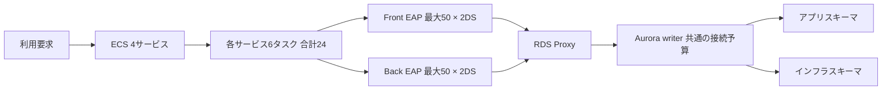

# JBoss EAP 8.1・RDS Proxy・Aurora Serverless v2 MySQL 8.4 接続プール評価

調査基準日：2026-10-17（日本時間）

本資料は、提示された構成と公式資料に基づく評価です。実システムのログ・設定・負荷試験結果は未取得です。「確認済みの仕様」「計算」「原因の仮説」「ST用の提案」を区別しています。Excel版には再計算できる接続数・容量予算の試算を収録しています。

## 前提

| 項目 | 値・内容 | 確認方法・制約 |
|---|---|---|
| サービス数 | 4 | ユーザー提示 |
| コンテナ数／タスク | 2 | フロント・バック各1 |
| データソース数／コンテナ | 2 | アプリDB・インフラDB用。1ユーザー・分割なしを計算の基本前提 |
| 現在タスク数／サービス | 1 | 依頼の乗算から各サービス1と解釈 |
| STタスク数／サービス | 6 | 依頼の50×6×8から各サービス6と解釈。全体で24タスク |
| フロント 初期／最小／最大 | 2 / 2 / 15 | 各DS |
| バック 初期／最小／最大 | 10 / 10 / 20 | 各DS |
| 50案 | フロント・バックの各DS最大50 | 初期・最小は現行のままとした比較 |
| DB配置 | 同じAuroraクラスターの別スキーマ | ユーザー追加回答で確認済み |
| トランザクション | Narayanaのグローバルトランザクション・2PC | 実際の参加RM、JVM間伝播、XA設定は未確認 |
| エラー／警告ID | 未確認 | ユーザー回答：不明。IJ000100/IJ000655は説明用の代表例 |
| 最小／最大ACU、max_connections | 未確認 | 実機取得が必要 |
| ドライバー、Proxy設定、タイムアウト | 未確認 | 実機取得が必要 |
| 更新方式・maximumPercent | 未確認 | 試算の200%は説明用の仮定 |
| 実測値の扱い | 推測で補完しない | 数式の実設定欄は空欄で提供。提案・例示を明記 |

## 1. 接続枯渇の評価と推奨方針

同一Auroraクラスターの2スキーマ。調査基準日 2026-10-17。実ログ・実設定・負荷値は未取得。

### 最優先の結論

最大値を一律50にする変更は、現時点では推奨しません。まず返却漏れと接続を長く持つ処理を直します。

リークが残ると、上限拡大は故障までの時間を延ばすだけです。DB待ち・CPU・ロック競合を増やし、他サービスにも影響を広げる可能性があります。これは提示条件からの設計評価です。

[S03 Red Hat EAP 8.1：性能チューニング 第6章](https://docs.redhat.com/en/documentation/red_hat_jboss_enterprise_application_platform/8.1/html/performance_tuning_for_red_hat_jboss_enterprise_application_platform/assembly-datasource-resource-adapter-tuning_performance-tuning-guide)

### 接続数の答え

6タスク×4サービス×2コンテナ×2スキーマ×50で、合計4,800枠です。

「1スキーマ2,400」は正しい計算です。同じwriterへ接続するので、2スキーマ合計で容量評価します。上限枠は実接続数ではありません。サブプール分割、回復用、運用接続は別途加算します。

[S02 Red Hat EAP 8.1：属性・統計・トランザクション設定](https://docs.redhat.com/en/documentation/red_hat_jboss_enterprise_application_platform/8.1/html/configuration_guide/reference_material) [S13 AWS：RDS Proxyの制約](https://docs.aws.amazon.com/AmazonRDS/latest/AuroraUserGuide/rds-proxy.html)

### 現行値との比較

現在の最大15／20のままなら、各サービス1タスクで280枠、6タスクで1,680枠です。

初期・最小の設定値の合計は1タスクで96、6タスクで576です。実際にその数が起動直後から作られるかはprefill等によります。50案は現行上限の約2.86倍です。

計算

### 更新中も数える

新旧タスクが全部重なる条件では、50案は9,600枠になります。

maximumPercent=200%で4サービスが同時に入れ替わり、各サービス12タスクが接続する想定例です。実際の更新方式・順序・停止中の残存接続を確認します。通常時だけで上限を決めません。

[S15 AWS：ECS DeploymentConfiguration](https://docs.aws.amazon.com/AmazonECS/latest/APIReference/API_DeploymentConfiguration.html)

### 自動回復の答え

処理が終了して接続が返れば回復します。単に時間を待つだけでは、必ず回復するとはいえません。

blocking-timeoutは借りたい側を諦めさせます。idle-timeoutは返却済みの未使用接続を閉じます。どちらも貸出中のリークを一定時間で回収する保証ではありません。

[S02 Red Hat EAP 8.1：属性・統計・トランザクション設定](https://docs.redhat.com/en/documentation/red_hat_jboss_enterprise_application_platform/8.1/html/configuration_guide/reference_material)

### 警告の読み方

「代わりに閉じた」という警告があっても、すべての接続が返った証明にはなりません。

警告ID・対象がConnectionかStatementか・同一トランザクションの終了・InUseCount低下を突き合わせます。現時点で「リーク＋プールタイムアウトが原因」とは断定できません。

[S04 Red Hat：IJ000100の説明](https://access.redhat.com/solutions/18573) [S05 Red Hat：CCMによるリーク検出](https://access.redhat.com/solutions/309913)

### Proxyの答え

ProxyはDB接続を使い回す手助けをしますが、EAPの返却漏れを直すことはできません。

短い処理を順番に流せると効きます。同時実行中の処理やpinningが多いと削減効果は小さくなります。4,800枠を何分の1にできるかは実測が必要です。

[S08 AWS：RDS Proxyの概念](https://docs.aws.amazon.com/AmazonRDS/latest/AuroraUserGuide/rds-proxy.howitworks.html)

### 同じAuroraなら

2つの帳面を1つの窓口から更新できるなら、1接続・1トランザクションへの整理を検討します。

同一writer、InnoDB、1セッション、必要な権限、同一トランザクション境界が条件です。2スキーマあることだけを理由にXAが必須になるわけではありません。外部JMS等が参加すれば別判断です。

[S16 MySQL 8.4：XAトランザクション](https://dev.mysql.com/doc/refman/8.4/en/xa.html) [S30 MySQL 8.4：COMMIT / ROLLBACK](https://dev.mysql.com/doc/refman/8.4/en/commit.html)

### ローリング更新の答え

回復しないタスクの交換は復旧手段になります。ただしXAの未完了処理を残さない準備が要ります。

ドレイン、Narayanaログの永続化、識別子と回復主体の対応、XA RECOVERでの確認を行います。全タスクの一斉再起動やトランザクションログ削除は復旧手順にしません。

[S01 Red Hat EAP 8.1：データソース管理](https://docs.redhat.com/en/documentation/red_hat_jboss_enterprise_application_platform/8.1/html/configuration_guide/datasource_management) [S17 MySQL 8.4：XA状態遷移](https://dev.mysql.com/doc/refman/8.4/en/xa-states.html) [S34 Red Hat EAP 8.1：設定ガイド全体](https://docs.redhat.com/en/documentation/red_hat_jboss_enterprise_application_platform/8.1/html-single/configuration_guide/configuration_guide)

### 今回の提案値の位置づけ

最初は最大15／20を維持し、改善後に必要な場所だけ増減します。

バックの初期・最小10→2は、起動性能をSTで確かめる候補です。初期・最小を下げても最大枠1,680は変わりません。最終値を決める材料は借用時間、到着率、同時利用数、DB処理能力です。

評価

### 資料の使い方

接続数試算で数を確認し、タイムアウトと復旧で待つか交換するかを判断します。

詳しい仕組み、XA、Proxy、原因の見分け方、コマンド、改善・試験、出典を続けて収録しました。灰色の入力欄と数式は編集可能です。空欄の実設定は推測で埋めていません。

## 接続数の計算

「6タスク」は各サービス6、合計24タスクです。各タスクに2コンテナがあり、各コンテナに2データソースがあります。通常は合計96プールです。

```text
1スキーマの最大枠 = 4サービス × タスク数 × (Front最大 + Back最大)
2スキーマ合計の最大枠 = 1スキーマの最大枠 × 2
初期・最小の設定合計 = 4サービス × タスク数 × (Front最小 + Back最小) × 2
```

| 条件 | タスク／サービス | Front最大 | Back最大 | プール総数 | 1スキーマ最大 | 2スキーマ最大 | 初期・最小設定合計 |
|---|---:|---:|---:|---:|---:|---:|---:|
| 現行・1タスク | 1 | 15 | 20 | 16 | 140 | 280 | 96 |
| 現行・ST 6タスク | 6 | 15 | 20 | 96 | 840 | 1,680 | 576 |
| 50案・1タスク | 1 | 50 | 50 | 16 | 400 | 800 | 96 |
| 50案・ST 6タスク | 6 | 50 | 50 | 96 | 2,400 | 4,800 | 576 |
| 現行・ST更新重複 | 12 | 15 | 20 | 192 | 1,680 | 3,360 | 1,152 |
| 50案・ST更新重複 | 12 | 50 | 50 | 192 | 4,800 | 9,600 | 1,152 |

※サブプール分割なしの基本計算。XA回復・トランザクションログ保存・管理・監視・他システムの接続は含みません。更新中はmaximumPercent=200%、全サービス同時、新旧とも接続する仮定です。



### 保守的なDB予算の計算

すべてのEAP枠がDB接続を占有する仮定です。Proxyで共有できる場合は、需要Dを測定値へ置き換えます。

| 条件 | 需要D | 必要Proxy枠 B≧1.3D | MaxConnectionsPercent=80%での概算DB下限 |
|---|---:|---:|---:|
| 現行 ST定常 | 1,680 | 2,184 | 2,730 |
| 50案 ST定常 | 4,800 | 6,240 | 7,800 |
| 50案 ST更新重複 | 9,600 | 12,480 | 15,600 |

概算DB下限は内部予約を含みません。DB全体の予算とProxy内の余裕は別です。Bは `MaxDatabaseConnectionsAllowed` の実測で確認します。[S09 AWS：RDS Proxy接続設定](https://docs.aws.amazon.com/AmazonRDS/latest/AuroraUserGuide/rds-proxy-connections.html)

### 実測から1プールの大きさを求める

平均同時利用数 ≒ 到着率λ（件/秒）× 接続保持時間W（秒）× 1件が同時に使う接続数。これは平均のLittleの法則の使い方であり、最大値の保証ではありません。

説明用の例：40件/秒 × 0.2秒 × 1接続 = 平均8接続。目標使用率70%と予備2本なら `ceil(8 / 0.7) + 2 = 14` が試算値です。Wが2秒なら平均80接続となり、設定拡大より先に保持時間を疑います。実負荷のp95/p99、偏り、入れ子TX、再試行、障害時を確認します。


## 2. 接続プールを学校の道具にたとえる

最初に身近な例、次に実際の仕組みを説明します。歴史は問題が増えた順に整理しています。

### コネクション

DBに相談するための「電話回線」です。回線を作るたびに、相手を探して本人確認をします。

実際にはTCP接続、TLS、認証、セッション初期化等が必要です。SQLは回線を通して送ります。接続が多いとDB側にも管理用メモリー等の負担が増えます。

[S08 AWS：RDS Proxyの概念](https://docs.aws.amazon.com/AmazonRDS/latest/AuroraUserGuide/rds-proxy.howitworks.html)

### プール

毎回電話を設置する代わりに、何台か用意して皆で借りる「貸出箱」です。

JBoss EAPのdatasourcesサブシステムではIronJacamarが接続を管理します。アプリはJNDIのDataSourceから借り、使用後closeします。毎回物理回線を切る必要はありません。

[S01 Red Hat EAP 8.1：データソース管理](https://docs.redhat.com/en/documentation/red_hat_jboss_enterprise_application_platform/8.1/html/configuration_guide/datasource_management) [S23 Oracle Java：DataSourceとプール](https://docs.oracle.com/javase/tutorial/jdbc/basics/sqldatasources.html)

### 初期値2

貸出箱を用意するときの、最初の道具数の指定です。

initial-pool-sizeは初期の目標です。起動時の作成タイミングにはpool-prefillやプール実装等が関わります。「設定したから起動時に必ず2本」とはせずCreatedCount等で確認します。

[S02 Red Hat EAP 8.1：属性・統計・トランザクション設定](https://docs.redhat.com/en/documentation/red_hat_jboss_enterprise_application_platform/8.1/html/configuration_guide/reference_material)

### 最小値2

道具を減らすときの、最低数の目安です。

min-pool-sizeを厳密に守るかはpool-use-strict-min等にも依存します。障害で破棄された瞬間も含め常時2本を保証する値ではありません。初期値と役割が違います。

[S03 Red Hat EAP 8.1：性能チューニング 第6章](https://docs.redhat.com/en/documentation/red_hat_jboss_enterprise_application_platform/8.1/html/performance_tuning_for_red_hat_jboss_enterprise_application_platform/assembly-datasource-resource-adapter-tuning_performance-tuning-guide)

### 最大値15

同じ貸出箱が持てる道具数の上限です。

最大値は貸出中と待機中を合わせた物理接続管理の上限です。1アプリ利用者につき1本ではありません。通常は需要に応じて増えるので、最大15でも常時15本とは限りません。

[S02 Red Hat EAP 8.1：属性・統計・トランザクション設定](https://docs.redhat.com/en/documentation/red_hat_jboss_enterprise_application_platform/8.1/html/configuration_guide/reference_material)

### 2つの貸出箱

アプリDB用とインフラDB用は、別々の箱です。片方の空きはもう片方へ自動的には移りません。

通常、別データソースは別プールです。インフラ側が空いていてもアプリ側が枯渇すれば借用は失敗します。コンテナ・JVM・タスクが異なっても箱は独立です。

設計前提

### Proxyは共通受付

各教室の貸出箱の先に、学校全体の受付があるイメージです。

EAP→Proxyの接続とProxy→Auroraの接続は別です。Proxyは安全に共有できるDB接続を各クライアントへ割り当てます。EAP内のプール上限や貸出帳を書き換えることはできません。

[S08 AWS：RDS Proxyの概念](https://docs.aws.amazon.com/AmazonRDS/latest/AuroraUserGuide/rds-proxy.howitworks.html)

### 同じDBサーバー

「アプリDB」と「インフラDB」は、同じ図書館の別の本棚です。

MySQLのdatabase/schemaの区切りは、別サーバーや別接続上限を意味しません。本件では同じAurora writerの接続予算、CPU、メモリー、I/Oを共有します。

利用者確認 [S13 AWS：RDS Proxyの制約](https://docs.aws.amazon.com/AmazonRDS/latest/AuroraUserGuide/rds-proxy.html)

### トランザクション

2つの帳面への書き込みを「全部できた」か「全部なかったこと」にする約束です。

注文と残高の一方だけが更新されると矛盾します。トランザクションはまとまった更新をcommit/rollbackで確定・取消しします。読み取りやロックも処理時間に関係します。

[S30 MySQL 8.4：COMMIT / ROLLBACK](https://dev.mysql.com/doc/refman/8.4/en/commit.html)

### 2PC

先生が全員に「準備できた？」と聞き、そろってから「確定して」と伝える2段階の方法です。

第1段階prepare、第2段階commit。投票失敗ならrollbackを決定します。一度commitを決めて一部へ伝達した後の通信障害は、回復処理で決定を伝え直す必要があります。

[S16 MySQL 8.4：XAトランザクション](https://dev.mysql.com/doc/refman/8.4/en/xa.html)

### Narayana

その先生役です。名前の正式なつづりはNarayanaです。

EAPのトランザクションマネージャーです。JTA/Jakarta Transactionsの境界とXAリソースを調整します。接続プールそのものを担当するIronJacamarとは責務が異なります。

[S34 Red Hat EAP 8.1：設定ガイド全体](https://docs.redhat.com/en/documentation/red_hat_jboss_enterprise_application_platform/8.1/html-single/configuration_guide/configuration_guide)

### リーク

借りた道具を返し忘れて、貸出帳ではずっと貸出中になることです。

Connectionを返し忘れるほか、Statement/ResultSet/ストリームの未解放も問題になります。処理が長すぎて返せない状態は、真のリークと似た症状でも原因が異なります。

[S05 Red Hat：CCMによるリーク検出](https://access.redhat.com/solutions/309913) [S22 Oracle Java：try-with-resources](https://docs.oracle.com/javase/tutorial/essential/exceptions/tryResourceClose.html)

### タイムアウト

いろいろな場所にある「待つのをやめる時計」です。

借用の行列、SQLの実行、ネットワーク読取、トランザクション全体、未使用回線に別々の時計があります。1つを短くすれば全部が片付くわけではありません。

設計整理

### 必要になった背景1

ネットワーク越しのDB利用が増えると、毎回の接続準備がもったいなくなりました。

接続を再利用するプールは、接続確立コストを減らすために必要になりました。借りる・返すという所有権管理が新たに重要になり、返却漏れという故障も生じます。

[S03 Red Hat EAP 8.1：性能チューニング 第6章](https://docs.redhat.com/en/documentation/red_hat_jboss_enterprise_application_platform/8.1/html/performance_tuning_for_red_hat_jboss_enterprise_application_platform/assembly-datasource-resource-adapter-tuning_performance-tuning-guide) [S23 Oracle Java：DataSourceとプール](https://docs.oracle.com/javase/tutorial/jdbc/basics/sqldatasources.html)

### 必要になった背景2

利用者が増え、1つのプログラムが複数の帳面やシステムを更新するようになりました。

XAとトランザクションマネージャーは異なるリソース間の一貫性を扱います。引き換えにprepare/commit通信、ログ、障害回復、長く保持するロックの管理が必要になります。

[S16 MySQL 8.4：XAトランザクション](https://dev.mysql.com/doc/refman/8.4/en/xa.html)

### 2005年：Narayanaの系譜

長年育てられた取引管理の技術が、JBossへ引き継がれました。

Narayana公式史では2005年12月5日にArjuna/HP由来のトランザクション技術取得とオープンソース化を発表しています。現在のNarayanaにつながる経緯です。

[S24 Narayana：歴史](https://www.narayana.io/history/)

### クラウドで増えた問題

教室を増やすたびに貸出箱も増え、学校全体では道具が多すぎる状態になりました。

コンテナやサーバーレスの台数増加で、各プロセスの小さなプールが合計すると大きくなります。本件の50×6×8×2が、その典型です。

独自の例

### 2019〜2020年：Proxy

急に増えるアプリの接続を、DBの前で整理する受付が必要になりました。

RDS Proxyは2019年12月のプレビュー後、2020年6月30日に一般提供。アプリが急増しても、DBが接続確立と接続維持だけで疲れないようにする背景がありました。

[S25 AWS：RDS Proxy登場の背景](https://aws.amazon.com/blogs/compute/using-amazon-rds-proxy-with-aws-lambda/)

### 2022年：Serverless v2

混み具合に合わせて、図書館の作業力を伸ばす仕組みが登場しました。

2022年4月21日に一般提供。接続数を調整するProxyと、計算資源を伸縮するServerless v2は別の役割です。資源が自動で増えてもリークの返却は自動化されません。

[S26 AWS：Aurora変更履歴](https://docs.aws.amazon.com/AmazonRDS/latest/AuroraUserGuide/WhatsNew.html)

### 2026年：Aurora MySQL 8.4

DBの新しい世代に合わせて、接続ドライバーや認証の確認も必要です。

2026年5月21日に8.4が一般提供され、開始時はMySQL 8.4.7互換です。古い資料の「Auroraは8.0まで」という前提を使いません。実機のEngineVersionを記録します。

[S27 AWS：Aurora MySQL 8.4一般提供](https://aws.amazon.com/about-aws/whats-new/2026/05/amazon-aurora-mysql/8-4/)

### 歴史から得る判断

箱を増やす、受付を置く、作業力を増やす、返し忘れを直す。この4つは別の対策です。

本件はまず接続の所有権と保持時間を正し、次に必要同時数とDB能力を測り、最後にプール・Proxy・ACUの予算を合わせます。単一の数値で全問題を解決しようとしません。

評価


## 3. JBoss EAPの接続が借りられて戻るまで

datasourcesサブシステムの管理プールを前提とします。HikariCPやAgroal等をアプリ内で追加している場合は別途棚卸しします。

### 1. 取得

アプリがDataSource.getConnection()で道具を借ります。

空きがあれば再利用します。上限未満なら物理接続を作成する場合があります。最大まで使用中なら待機します。接続作成失敗・認証失敗も取得エラーになるため、枯渇とは区別します。

[S01 Red Hat EAP 8.1：データソース管理](https://docs.redhat.com/en/documentation/red_hat_jboss_enterprise_application_platform/8.1/html/configuration_guide/datasource_management)

### 2. 論理ハンドル

アプリが持つのは、回線を利用するための「貸出券」です。

JDBC Connectionラッパーを受け取ります。アプリがcloseすることと、プールが物理ソケットをdestroyすることは別です。この区別が、警告とDB接続数を読み解く鍵です。

[S23 Oracle Java：DataSourceとプール](https://docs.oracle.com/javase/tutorial/jdbc/basics/sqldatasources.html)

### 3. JTA参加

全体の約束の中で借りると、その接続がトランザクションに参加します。

XAリソースがenlistされます。同一トランザクション内での接続共有や紐付けは実装・設定・資格情報等に左右され、getConnection回数と物理接続本数は必ずしも一致しません。

[S16 MySQL 8.4：XAトランザクション](https://dev.mysql.com/doc/refman/8.4/en/xa.html) [S34 Red Hat EAP 8.1：設定ガイド全体](https://docs.redhat.com/en/documentation/red_hat_jboss_enterprise_application_platform/8.1/html-single/configuration_guide/configuration_guide)

### 4. SQLの実行

道具を使っている間だけでなく、次の指示を待つ間も貸出中になることがあります。

ロック待ち、バックサービスのHTTP応答待ち、ファイル処理、リトライ待機等を接続取得後に行うと、SQL自体が短くても接続保持時間が長くなります。

分析

### 5. close

使い終わった貸出券は必ず返します。

通常は論理ハンドルを閉じます。JTA中はclose済みでも、トランザクションとの関連が終わるまで他トランザクションへ再利用できない場合があります。closeだけをcommitと考えてはいけません。

[S23 Oracle Java：DataSourceとプール](https://docs.oracle.com/javase/tutorial/jdbc/basics/sqldatasources.html) [S34 Red Hat EAP 8.1：設定ガイド全体](https://docs.redhat.com/en/documentation/red_hat_jboss_enterprise_application_platform/8.1/html-single/configuration_guide/configuration_guide)

### 6. commit / rollback

全体の約束を終え、道具を次の人へ渡せる状態にします。

正常終了・取消し・afterCompletion・接続の正常性などの条件が満たされると再利用可能になります。不正な接続は破棄して必要に応じ再作成します。返却後もDBソケットが残るのはプールの通常動作です。

[S01 Red Hat EAP 8.1：データソース管理](https://docs.redhat.com/en/documentation/red_hat_jboss_enterprise_application_platform/8.1/html/configuration_guide/datasource_management) [S34 Red Hat EAP 8.1：設定ガイド全体](https://docs.redhat.com/en/documentation/red_hat_jboss_enterprise_application_platform/8.1/html-single/configuration_guide/configuration_guide)

### 7. idleの掃除

返されたまま長く使っていない道具を整理します。

idle-timeout-minutesとIdleRemover等が余分な未使用接続を閉じます。貸出中を「DBでSQLを実行していない」という理由だけで取り上げる機能ではありません。

[S02 Red Hat EAP 8.1：属性・統計・トランザクション設定](https://docs.redhat.com/en/documentation/red_hat_jboss_enterprise_application_platform/8.1/html/configuration_guide/reference_material)

### 接続枠の独立性

フロントが15本とも借りていたら、バックに空きがあってもその箱からは借りられません。

EAPの1JVM・1データソース単位で観測します。全コンテナの平均だけでは、特定タスクや特定データソースの枯渇を見落とします。

設計前提

### maxと空きの意味

箱に15本入っていることと、15本が使用中であることは違います。

ActiveCountは使用中だけを意味しません。InUseCountとIdleCountを確認します。AvailableCountには実装上の借用可能枠が反映される場合があるため、物理idle本数と同一視しません。

[S02 Red Hat EAP 8.1：属性・統計・トランザクション設定](https://docs.redhat.com/en/documentation/red_hat_jboss_enterprise_application_platform/8.1/html/configuration_guide/reference_material) [S03 Red Hat EAP 8.1：性能チューニング 第6章](https://docs.redhat.com/en/documentation/red_hat_jboss_enterprise_application_platform/8.1/html/performance_tuning_for_red_hat_jboss_enterprise_application_platform/assembly-datasource-resource-adapter-tuning_performance-tuning-guide)

### サブプール

同じ名前の箱の中に、利用者別の小箱ができる設定があります。

allow-multiple-users、認証コンテキスト、no-tx-separate-poolを棚卸しします。no-tx-separate-pool=trueではTX内外の2プールになるため、max設定の2倍となり得ます。4,800は分割なしの基本計算です。

[S02 Red Hat EAP 8.1：属性・統計・トランザクション設定](https://docs.redhat.com/en/documentation/red_hat_jboss_enterprise_application_platform/8.1/html/configuration_guide/reference_material)

### 初期・最小の効き方

小さい値は普段の持ち物を減らし、大きい値は起動直後の準備を増やします。

初期・最小を下げても最大の貸出能力は下がりません。一方、急増時の接続作成時間は増える可能性があります。pool-prefill、strict-min、破棄数を含めて起動試験と定常試験を行います。

[S03 Red Hat EAP 8.1：性能チューニング 第6章](https://docs.redhat.com/en/documentation/red_hat_jboss_enterprise_application_platform/8.1/html/performance_tuning_for_red_hat_jboss_enterprise_application_platform/assembly-datasource-resource-adapter-tuning_performance-tuning-guide)

### IJ000100の場合

「自分で返してね。今回は代わりに返した」という趣旨のメッセージです。

本件のIDは未取得です。IJ000100に一致するならCCMによる未closeの検出を疑います。取得元スタックを修正対象にします。呼出し境界を通過しないハング中処理まで全件救済する保証はありません。

[S04 Red Hat：IJ000100の説明](https://access.redhat.com/solutions/18573) [S05 Red Hat：CCMによるリーク検出](https://access.redhat.com/solutions/309913) [S06 Red Hat EAP 8.1：Jakarta Connectors管理](https://docs.redhat.com/en/documentation/red_hat_jboss_enterprise_application_platform/8.1/html/configuration_guide/jakarta-connectors-management_orb-configuration)

### Statementの警告の場合

鉛筆は片付けたが、机の貸出券はまだ返っていない、という可能性があります。

Statement/ResultSetの自動クローズ警告とConnectionの未返却は区別します。track-statementsはSQLリソースの追跡であり、貸出中Connectionを一定時間で強制回収する設定ではありません。

[S02 Red Hat EAP 8.1：属性・統計・トランザクション設定](https://docs.redhat.com/en/documentation/red_hat_jboss_enterprise_application_platform/8.1/html/configuration_guide/reference_material)

### 警告があっても枯渇する例1

先生が片付けても、全体の授業が終わらず次の人へ渡せないことがあります。

論理close後もJTAが完了していない、あるいはrollbackがDB応答待ちになっている場合です。警告の直後にInUseCountが減ったか、同じXIDの完了ログがあるかを確かめます。

分析 [S34 Red Hat EAP 8.1：設定ガイド全体](https://docs.redhat.com/en/documentation/red_hat_jboss_enterprise_application_platform/8.1/html-single/configuration_guide/configuration_guide)

### 警告があっても枯渇する例2

一部は返されたが、別の場所で返し忘れが続くことがあります。

例外、早期return、独自スレッド、管理外接続、二重プールなどの経路を調べます。「警告が出た接続」と「現在枯渇させている接続」が同一とは限りません。

分析 [S05 Red Hat：CCMによるリーク検出](https://access.redhat.com/solutions/309913)

### 警告があっても枯渇する例3

返却は正しくても、借りたい人が多すぎれば並びます。

リークなしの純粋な同時実行過多でも上限へ到達します。流入停止後にInUseCountが低下するか、同時処理数と接続保持時間が妥当かで切り分けます。

[S03 Red Hat EAP 8.1：性能チューニング 第6章](https://docs.redhat.com/en/documentation/red_hat_jboss_enterprise_application_platform/8.1/html/performance_tuning_for_red_hat_jboss_enterprise_application_platform/assembly-datasource-resource-adapter-tuning_performance-tuning-guide)

### 短い例で理解

プール15本の全部を各処理が40秒持ち、16人目が5秒待つ設定なら、16人目は5秒で失敗します。

最初の15処理が40秒後に正常終了すれば、その後の新しい要求は借りられます。失敗した16人目の要求が自動で成功に変わるわけではありません。再試行には別の設計が必要です。

独自の例

### リークの例

15人が貸出券を永遠に返さなければ、何分待っても箱は貸出中のままです。

idle-timeoutを1分にしても本質的に回収対象がありません。外部で回線が切れても、Java側の所有権・スレッド・トランザクションが解放されるまで枠が戻る保証はありません。

分析

### 安全なコード修正

借りた場所で必ず返す形にし、途中で失敗しても片付くようにします。

直接取得したConnection/PreparedStatement/ResultSetはtry-with-resourcesで所有します。JPAのコンテナ管理EntityManagerやフレームワーク所有接続を勝手にcloseせず、所有者の規約に従います。

[S22 Oracle Java：try-with-resources](https://docs.oracle.com/javase/tutorial/essential/exceptions/tryResourceClose.html)

### JTA中の注意

先生がまとめて決める約束に、途中で勝手な確定を混ぜません。

コンテナ管理トランザクション内でConnection.commit()/rollback()/setAutoCommit(true)を勝手に呼びません。業務例外時のrollback指定を明確にし、例外の握りつぶしをなくします。

[S16 MySQL 8.4：XAトランザクション](https://dev.mysql.com/doc/refman/8.4/en/xa.html) [S34 Red Hat EAP 8.1：設定ガイド全体](https://docs.redhat.com/en/documentation/red_hat_jboss_enterprise_application_platform/8.1/html-single/configuration_guide/configuration_guide)

### 観測を残す

貸出帳の数を、時間の流れで記録します。

サービス名、タスクID、コンテナ、データソース、時刻、InUse/Idle/待機、借用時間を紐付けます。秘密情報・SQLの個人情報は記録しません。診断debugは期間を限り、負荷も測ります。

提案


## 4. どの時計が切れると何が起きるか

「タイムアウトで自動回復するか」は時計の種類と、処理を実際に終了できるかで決まります。

### EAP：借用待ち

blocking-timeout-wait-millis。空き接続を待つ側の制限です。

単位ms。例：5000なら借用待ち5秒の設計候補。既存接続を強制回収しません。また新規接続確立全体の上限ではないので、JDBCのconnectTimeoutも必要です。実値は未確認です。

[S02 Red Hat EAP 8.1：属性・統計・トランザクション設定](https://docs.redhat.com/en/documentation/red_hat_jboss_enterprise_application_platform/8.1/html/configuration_guide/reference_material) [S19 MySQL Connector/J：通信設定](https://dev.mysql.com/doc/connector-j/en/connector-j-connp-props-networking.html)

### EAP：未使用時間

idle-timeout-minutes。返却済みで使われない接続を片付ける時計です。

単位分。EAP資料の未指定時は30分。実際の掃除時刻はスキャン周期等でずれます。長時間借用、JTA保持、SQL実行中の接続を回収する時計ではありません。

[S02 Red Hat EAP 8.1：属性・統計・トランザクション設定](https://docs.redhat.com/en/documentation/red_hat_jboss_enterprise_application_platform/8.1/html/configuration_guide/reference_material)

### JTA：全体の処理時間

default-timeout。全体の約束が長すぎたら取消しを進める時計です。

単位秒。EAP資料の既定300秒と実環境の値は別です。個別トランザクションの上書きも確認します。取消しはDB・ドライバー等の協力を要し、期限ちょうどのソケット解放は保証されません。

[S02 Red Hat EAP 8.1：属性・統計・トランザクション設定](https://docs.redhat.com/en/documentation/red_hat_jboss_enterprise_application_platform/8.1/html/configuration_guide/reference_material) [S29 Narayana公式ソース：TransactionReaper](https://github.com/jbosstm/narayana/blob/main/ArjunaCore/arjuna/classes/com/arjuna/ats/arjuna/coordinator/TransactionReaper.java)

### XA：参加先への伝達

xa-resource-timeout。参加するDBリソースへ時間制限を伝えるための設定です。

XAResource.setTransactionTimeoutをドライバーがどう扱うかに依存します。NarayanaのJTAタイムアウトと同じ機能だと決めつけず、実ドライバーで動作を確認します。

[S02 Red Hat EAP 8.1：属性・統計・トランザクション設定](https://docs.redhat.com/en/documentation/red_hat_jboss_enterprise_application_platform/8.1/html/configuration_guide/reference_material)

### JDBC：SQLの時間

query-timeoutやStatement.setQueryTimeout。1つのSQLを待つ上限です。

単位秒。EAPのquery-timeoutの既定は制限なし。set-tx-query-timeoutで残りTX時間を反映する方式もあります。取消し後のトランザクション処理・例外処理まで試験します。

[S02 Red Hat EAP 8.1：属性・統計・トランザクション設定](https://docs.redhat.com/en/documentation/red_hat_jboss_enterprise_application_platform/8.1/html/configuration_guide/reference_material)

### JDBC：接続作成

connectTimeout。新しい回線の接続処理に使う時計です。

Connector/Jではmsで、資料の既定0は制限なしです。EAPの借用待ちが短くても、DNS、接続確立、TLS、認証などの別区間をすべて同じ時計が覆うとは限りません。

[S19 MySQL Connector/J：通信設定](https://dev.mysql.com/doc/connector-j/en/connector-j-connp-props-networking.html)

### JDBC：通信応答

socketTimeout。ネットワーク読取等の待ちを制限します。

Connector/Jではms、資料の既定0は制限なし。SQL全体の実行時間とは意味が違います。タイムアウト時にcommit結果が不明となる場合があり、更新SQLを無条件再実行しません。

[S19 MySQL Connector/J：通信設定](https://dev.mysql.com/doc/connector-j/en/connector-j-connp-props-networking.html)

### Proxy：DB借用待ち

ConnectionBorrowTimeout。Proxy内でDB接続を借りるまで待ちます。

単位秒、既定120秒。EAP側ですでに接続を借りた処理がここで待つと、その間EAPの枠も占有し得ます。故障時の復旧待ちも含め、業務の応答期限より長い待ちを残さない設計にします。

[S09 AWS：RDS Proxy接続設定](https://docs.aws.amazon.com/AmazonRDS/latest/AuroraUserGuide/rds-proxy-connections.html)

### Proxy：クライアントidle

IdleClientTimeout。EAPからProxyへの接続で、SQL等が来ない時間を見ます。

既定1800秒。EAP内の「返却済み」とは別基準です。定期SELECT 1やCOM_PINGはidle判定を更新します。Proxyが切った後はEAPの検証・破棄・再作成が必要になります。

[S09 AWS：RDS Proxy接続設定](https://docs.aws.amazon.com/AmazonRDS/latest/AuroraUserGuide/rds-proxy-connections.html) [S28 AWS：RDS Proxy構成ガイド](https://docs.aws.amazon.com/AmazonRDS/latest/UserGuide/rds-proxy-best-practices.configuration.html)

### Proxy：接続寿命

長く使い続ける接続にも寿命があります。

AWSの構成ガイドは最大接続寿命24時間を記載しています。これはリーク枠の回復SLAではありません。切断を正しく検出して再作成できることを、長時間試験で確かめます。

[S28 AWS：RDS Proxy構成ガイド](https://docs.aws.amazon.com/AmazonRDS/latest/UserGuide/rds-proxy-best-practices.configuration.html)

### MySQL：セッションidle

wait_timeoutはDBセッション側の未使用時間です。

Proxy経由では管理対象の回線とセッション状態を確認します。DBでSleepでもEAPで貸出中、JTA未完了の場合があります。wait_timeoutを短くしてJavaのリークを解決しようとしません。

設計評価 [S10 AWS：RDS Proxyのpinning](https://docs.aws.amazon.com/AmazonRDS/latest/AuroraUserGuide/rds-proxy-pinning.html)

### MySQL：ロック待ち

innodb_lock_wait_timeoutは、更新対象を他処理が持っているときの待ち時間です。

接続プールの借用待ちとは別です。SQLの失敗後にトランザクションを終了する処理が必要です。長いTX、ロック順序、索引不足を改善しないまま値だけ増やすと待ちが積み上がります。

分析

### Web側の応答期限

ブラウザーやロードバランサーが諦めても、裏側のSQLがまだ動くことがあります。

HTTPのタイムアウト、クライアント切断、Javaスレッド取消し、JTA取消しは自動的に全段へ伝播するとは限りません。入口で流量を制限し、期限と取消しを明示します。

設計提案

### 時間予算の作り方

入口から出口までを1枚の時間割にします。

例：応答期限60秒、JTA45秒、EAP借用3秒、Proxy借用5秒、SQL10秒はST用の仮案です。複数SQLや複数回借用は足し合わせ、残り時間を考慮します。socketTimeout例15秒は応答単位なので単純な総和保証にはなりません。

仮案

### 時間値を決める基準

速い処理と夜間バッチに、同じ時間割を押し付けません。

業務SLO、正常時p95/p99、フェイルオーバー復旧目標、リトライ、rollback時間をもとに調整します。短すぎる制限は正常処理を壊し、長すぎる制限は接続保持を長引かせます。

提案

### 待てば回復：正常な混雑

処理が終わって返却が進むなら、流入を減らして待つことで回復できます。

流入制限後、InUseCountが下がり、待機中スレッドが解消し、新規取得が成功することを確認します。WaitCountは待機を経験した要求の累積指標として増分を見ます。元の失敗要求は失敗として扱います。

判断 [S02 Red Hat EAP 8.1：属性・統計・トランザクション設定](https://docs.redhat.com/en/documentation/red_hat_jboss_enterprise_application_platform/8.1/html/configuration_guide/reference_material)

### 待てば回復：取消し成功

JTAタイムアウト後のrollbackが完了すれば、接続を再利用または再作成できます。

条件付きです。TransactionReaperの警告だけで完了とせず、対象XIDの終了、プール統計低下、DBのTX・ロック解消を確認します。

[S29 Narayana公式ソース：TransactionReaper](https://github.com/jbosstm/narayana/blob/main/ArjunaCore/arjuna/classes/com/arjuna/ats/arjuna/coordinator/TransactionReaper.java)

### 待つだけでは不十分：リーク

所有者が返さず、回収も働かない場合は空きが戻りません。

原因コードを直し、対象タスクをドレインして交換する候補です。例外的な切断に頼って時間を待つ運用は、復旧時刻を予測できません。

判断

### 待つだけでは不十分：ハング

処理が通信やロック等で止まり、取消しも完了しない場合があります。

スレッドダンプ、DB側待機、ネットワーク、ドライバーを調べます。負荷遮断・診断採取後、復旧要件に応じて段階的なタスク交換を判断します。

判断

### 待つだけでは不十分：PREPARED

先生の最終指示を待つ約束は、アプリを入れ替えただけでは終わらないことがあります。

XA PREPAREDは接続終了後も残り得ます。接続数は減ってもロックが残る場合があるため、Narayana recoveryで結論を確定します。根拠なしのXA COMMIT/ROLLBACKは行いません。

[S17 MySQL 8.4：XA状態遷移](https://dev.mysql.com/doc/refman/8.4/en/xa-states.html) [S18 MySQL 8.4：XA SQL](https://dev.mysql.com/doc/refman/8.4/en/xa-statements.html)

### 軽い復旧：invalid flush

壊れた未使用接続を取り除き、作り直す方法があります。

flush-invalid-connection-in-poolはvalidationで無効と判断されたものが対象です。flush-idle-connection-in-poolは未使用分。貸出中のリーク回収を期待しません。

[S01 Red Hat EAP 8.1：データソース管理](https://docs.redhat.com/en/documentation/red_hat_jboss_enterprise_application_platform/8.1/html/configuration_guide/datasource_management)

### 軽い復旧：graceful flush

返ってきたものから順に交換します。

flush-gracefully-connection-in-poolは使用中の接続がidleになるのを待ちます。永遠に返らないものへの即効策ではありません。操作は実環境の運用判断で行います。

[S01 Red Hat EAP 8.1：データソース管理](https://docs.redhat.com/en/documentation/red_hat_jboss_enterprise_application_platform/8.1/html/configuration_guide/datasource_management)

### 強い復旧：all flush

使っている接続にも影響する強い操作です。

flush-all-connection-in-poolや強制タスク停止は処理失敗・結果不明・XA回復を招きます。自動クローズ警告が出たという理由だけで一斉に実行する手順にしません。

[S01 Red Hat EAP 8.1：データソース管理](https://docs.redhat.com/en/documentation/red_hat_jboss_enterprise_application_platform/8.1/html/configuration_guide/datasource_management) [S17 MySQL 8.4：XA状態遷移](https://dev.mysql.com/doc/refman/8.4/en/xa-states.html)

### 交換後の確認

新しいタスクが元気なだけでなく、古い約束が片付いたことを確認します。

両スキーマの整合性、未完了XID、回復ログ、再試行による二重処理、接続数・待機数の安定を確認して復旧完了とします。

提案


## 5. 2PCの必要性とタスク交換時の安全な回復

同じAuroraの別スキーマという確認結果を反映しています。XA不要化は条件付きの設計変更案です。

### 現在の2PC

アプリDBとインフラDBの2つの担当へ、Narayanaが同じ取引の参加を依頼します。

2データソースを実際に借用する経路では、1つの取引が両方の接続を保持し得ます。ただし2PCだからプール数がさらに2倍になるわけではありません。2データソース分はすでに計算済みです。

設計評価

### prepareの意味

各担当が「後で必ず確定できる準備ができた」と約束します。

PREPARED後のリソースは、コーディネーターの決定を待ちます。prepareが成功してもcommitが済んだ意味ではありません。途中障害に備えたログが必要です。

[S16 MySQL 8.4：XAトランザクション](https://dev.mysql.com/doc/refman/8.4/en/xa.html) [S17 MySQL 8.4：XA状態遷移](https://dev.mysql.com/doc/refman/8.4/en/xa-states.html)

### commit決定後の障害

片方に「確定して」と伝わり、もう片方への電話が切れることがあります。

このとき全体を勝手にrollbackへ変えてはいけません。永続化した決定に基づいてcommitを再送する等の回復が必要です。「2PCならエラー時に必ず両方即rollback」は誤りです。

[S16 MySQL 8.4：XAトランザクション](https://dev.mysql.com/doc/refman/8.4/en/xa.html) [S34 Red Hat EAP 8.1：設定ガイド全体](https://docs.redhat.com/en/documentation/red_hat_jboss_enterprise_application_platform/8.1/html-single/configuration_guide/configuration_guide)

### 接続解放とXA解決

電話が切れたことと、帳面への書き込みが確定したことは別です。

MySQL 8.4はxa_detach_on_prepareを備え、準備済みTXをセッションから離せます。実際のAurora設定を確認します。接続が減ってもPREPAREDとロックが消えるとは限りません。

[S17 MySQL 8.4：XA状態遷移](https://dev.mysql.com/doc/refman/8.4/en/xa-states.html)

### 同一サーバーの2スキーマ

同じ図書館の2冊なら、1人が1つの受付で両方を更新できる場合があります。

同じwriter上のInnoDBテーブルを、同じJDBC接続からapp_schema.tableとinfra_schema.tableで参照すれば、1つのDBトランザクションで原子性を持たせる設計が可能です。

[S30 MySQL 8.4：COMMIT / ROLLBACK](https://dev.mysql.com/doc/refman/8.4/en/commit.html)に基づく設計案

### 統合の前提

同じ人が両方の帳面へ書いてよいことが必要です。

同一接続で両スキーマに必要最小限の権限があること、同一業務境界、非トランザクションテーブルや暗黙commitのDDLを混在させないことを確認します。権限分離が必須なら単純統合しません。

[S30 MySQL 8.4：COMMIT / ROLLBACK](https://dev.mysql.com/doc/refman/8.4/en/commit.html)

### 統合してはいけない例

別のメッセージシステムも同時に確定する約束があれば、DBだけまとめても終わりません。

JMS、別クラスター、別RM、外部システムが参加している場合はXA継続や別の一貫性方式を評価します。2つの非XAデータソースへ切り替えるだけでは全体の原子性を失います。

[S16 MySQL 8.4：XAトランザクション](https://dev.mysql.com/doc/refman/8.4/en/xa.html)

### 設計案A：XAを維持

今の約束を守りながら、返却漏れと長い保持時間を直します。

最初の対策として変更範囲が小さく、業務の一貫性要件を保持できます。ドライバー・Proxy経由XA・回復・識別子・永続ログの障害試験が必要です。

提案

### 設計案B：1データソース

同一writer・同一接続に統一し、2スキーマを1取引で更新します。

1コンテナ当たりのデータソースを2→1にできれば、同じ上限の単純計算では接続枠を半分にできます。現在の最大15／20を仮に維持すれば6タスク合計840枠ですが、共用による負荷を再測定します。

計算・提案

### 設計案C：DB処理を集約

フロントは受付、バックはDB担当に分けられるか検討します。

フロントでDB接続を持ったままバックの応答を待つ経路を減らします。フロントDB接続を廃止できれば、バック最大20×4サービス×6タスク×2DS=960枠の計算例。業務設計・権限・遅延の評価が必要です。

計算・提案

### 段階的な選択

いきなり大改造せず、まずAで安定させ、B/Cの効果と影響を比較します。

ローカルトランザクションへの統合は、正常・例外・部分障害・同時更新の整合性試験を伴う別変更として進めます。単に設定フラグを切る作業ではありません。

提案

### isSameRMの注意

同じDB担当だと認識する仕組みも、ドライバーの版で変わります。

Connector/J 9.5.0では、isSameRMがDB名を比較していた点の修正が記載されています。現在のドライバーは未確認です。DB名が違えば常に別RM、常に2PCになるとは断定しません。

[S21 MySQL Connector/J 9.5.0リリースノート](https://dev.mysql.com/doc/relnotes/connector-j/en/news-9-5-0.html)

### 勝手な最適化を避ける

本当は別の担当なのに同じ担当だと教えると、約束を壊す恐れがあります。

same-rm-override、wrap-xa-resource、interleaving、pinGlobalTxToPhysicalConnection等は、その意味・対応状況を確認せず変更しません。通常経路だけでなくrecoveryまで試験します。

提案 [S32 WildFly 35：XA datasource管理モデル](https://docs.wildfly.org/35/wildscribe/subsystem/datasources/xa-data-source/index.html)

### JVMをまたぐ境界

フロントとバックに先生役がいても、自動で1つの約束になるとは限りません。

通常のHTTP/REST呼出しだけでJTAコンテキストが伝播すると考えないでください。EJB Remoting/JTS等の伝播方式か、独立TXかを確認します。8コンテナあることと8参加者2PCは別です。

[S34 Red Hat EAP 8.1：設定ガイド全体](https://docs.redhat.com/en/documentation/red_hat_jboss_enterprise_application_platform/8.1/html-single/configuration_guide/configuration_guide)

### ECSと永続ログ

タスクを交換しても、先生の「最終決定メモ」をなくしてはいけません。

Narayana object storeがコンテナの一時領域だけにあると、タスク消滅で回復の根拠を失います。永続ストア、または対応を確認したJDBC object storeを設計します。保存しただけで自動継承されるわけではありません。

[S34 Red Hat EAP 8.1：設定ガイド全体](https://docs.redhat.com/en/documentation/red_hat_jboss_enterprise_application_platform/8.1/html-single/configuration_guide/configuration_guide)

### 識別子と回復の所有者

同時に動く先生の名前は重複させず、退任した先生の宿題を誰が引き受けるかを決めます。

node-identifierは同時稼働TMで一意にします。一方、起動ごとに無関係なIDへ変更するだけでは旧XIDを回復できない恐れがあります。旧ID・ストアと回復主体の対応、競合防止を設計します。

[S02 Red Hat EAP 8.1：属性・統計・トランザクション設定](https://docs.redhat.com/en/documentation/red_hat_jboss_enterprise_application_platform/8.1/html/configuration_guide/reference_material) [S34 Red Hat EAP 8.1：設定ガイド全体](https://docs.redhat.com/en/documentation/red_hat_jboss_enterprise_application_platform/8.1/html-single/configuration_guide/configuration_guide)

### 回復用DB接続

事故を片付ける人にも、作業用の窓口が必要です。

通常プールの最大枠以外に回復用・ログ保存用接続を考慮します。回復資格情報、XA_RECOVER_ADMIN等の必要権限、TLS、到達性を確認します。無制限権限をアプリへ付与する必要はありません。

[S01 Red Hat EAP 8.1：データソース管理](https://docs.redhat.com/en/documentation/red_hat_jboss_enterprise_application_platform/8.1/html/configuration_guide/datasource_management) [S18 MySQL 8.4：XA SQL](https://dev.mysql.com/doc/refman/8.4/en/xa-statements.html)

### ログをDBへ置く場合

メモ保存のための接続が、メモが必要な同じ処理に巻き込まれないようにします。

EAPのJDBC object store用は適切な非XAデータソースを使用します。業務XAプールと混同せず、接続数と障害時の到達性を別計上します。具体設定はサポートされる構成で設計します。

[S02 Red Hat EAP 8.1：属性・統計・トランザクション設定](https://docs.redhat.com/en/documentation/red_hat_jboss_enterprise_application_platform/8.1/html/configuration_guide/reference_material)

### Proxy経由のXA検証

受付を通したときも、準備・確定・回復がすべてできるかを実機で確かめます。

確認したAWS公開の制限・pinningページだけでは、本件のNarayana＋ドライバー＋Aurora版のXA全経路を保証できません。「XAは必ず非対応」「XAなら必ず固定化」とは断定しません。

[S10 AWS：RDS Proxyのpinning](https://docs.aws.amazon.com/AmazonRDS/latest/AuroraUserGuide/rds-proxy-pinning.html) [S13 AWS：RDS Proxyの制約](https://docs.aws.amazon.com/AmazonRDS/latest/AuroraUserGuide/rds-proxy.html)

### 確認する障害点

準備前、準備直後、片方commit後でタスクや通信を止める試験を分けます。

隔離したSTで、取引IDごとの両スキーマの整合性、XA RECOVER残数、Narayana回復完了、二重更新防止を確認します。準備済みTXの手動判断には永続決定ログが必要です。

提案


## 6. Proxyが助けられる範囲とDBの容量

アプリ側の4,800枠と、Auroraへの実接続数・実行能力を分けて評価します。

### 2段のプール

教室ごとの箱がEAP、学校全体の受付がProxyです。

EAPは同一JVM内での再利用を担当し、Proxyは多数のクライアント間でDB接続を共有します。接続確立の負担軽減や接続予算の制限には有効ですが、漏れたJavaオブジェクトは回収しません。

[S08 AWS：RDS Proxyの概念](https://docs.aws.amazon.com/AmazonRDS/latest/AuroraUserGuide/rds-proxy.howitworks.html)

### 多重化が効く例

たくさんの人が短い用事を順番に済ませるなら、受付は少ない窓口で対応できます。

クライアントが4,800接続あっても、同時にDBを使用するものが少なく、状態を安全に切替可能なら、DB実接続は少なくできます。削減倍率を固定値で仮定して本番容量を決めません。

[S08 AWS：RDS Proxyの概念](https://docs.aws.amazon.com/AmazonRDS/latest/AuroraUserGuide/rds-proxy.howitworks.html)

### 多重化が効かない例

全員が同時に長い相談をすれば、少ない窓口では待ち行列になります。

長時間トランザクション、SQL/ロック待ち、セッション固定化が多いとDB接続の占有が続きます。Proxyは許容量を超える負荷を待たせるか失敗させ、DBの処理能力そのものを増やしません。

[S13 AWS：RDS Proxyの制約](https://docs.aws.amazon.com/AmazonRDS/latest/AuroraUserGuide/rds-proxy.html)

### pinningの意味

ある人専用の窓口になり、ほかの人が使えなくなる状態です。

セッション状態を守るためDB接続を固定します。通常のトランザクション中の占有と、セッション終了まで続くpinningは区別します。pinning率は実測します。

[S10 AWS：RDS Proxyのpinning](https://docs.aws.amazon.com/AmazonRDS/latest/AuroraUserGuide/rds-proxy-pinning.html)

### 固定化のきっかけ

一時テーブル、名前付きロック、大きなSQLなどを使うと専用窓口が必要になることがあります。

AWSはMySQLのprepared statement、16KB超のSQL文、特定SET、GET_LOCK、明示table lock等を列挙しています。実行SQLとドライバー動作を照合し、必要な機能を無条件に削除しません。

[S10 AWS：RDS Proxyのpinning](https://docs.aws.amazon.com/AmazonRDS/latest/AuroraUserGuide/rds-proxy-pinning.html)

### JavaのPreparedStatement

JavaでPreparedStatementを使っただけで、必ず同じ動作になるとは限りません。

Connector/JのuseServerPrepStmtsやuseCursorFetch等により、サーバー側prepareかクライアント側処理かが変わります。プレースホルダーによる安全なSQLは維持し、文字列連結へ置き換えません。

[S20 MySQL Connector/J：Prepared Statements](https://dev.mysql.com/doc/connector-j/en/connector-j-connp-props-prepared-statements.html) [S33 MySQL Connector/J：性能拡張](https://dev.mysql.com/doc/connector-j/en/connector-j-connp-props-performance-extensions.html)

### XAと固定化

XAだから一律に何倍と決めず、実際の占有と固定化を測ります。

2PCの保持時間が延びればEAPとDBの需要は増えます。MySQLのdetachやドライバーの関連付けもあるため、SessionPinned、InTransaction、Borrowedを分けて記録します。

[S11 AWS：RDS ProxyのCloudWatch指標](https://docs.aws.amazon.com/AmazonRDS/latest/AuroraUserGuide/rds-proxy.monitoring.html) [S17 MySQL 8.4：XA状態遷移](https://dev.mysql.com/doc/refman/8.4/en/xa-states.html)

### DB側の上限B

Proxyがアプリへ貸せるDB接続数をBとします。

BはCloudWatchのMaxDatabaseConnectionsAllowedを優先します。max_connections×MaxConnectionsPercentは概算で、Proxyの内部予約等により一致しないことがあります。

[S09 AWS：RDS Proxy接続設定](https://docs.aws.amazon.com/AmazonRDS/latest/AuroraUserGuide/rds-proxy-connections.html)

### 2つの余裕

DB全体に残す余裕と、Proxyの枠内に残す余裕は別です。

例：max_connections=3,000、MaxConnectionsPercent=80%なら概算2,400。DB外側の約600は管理・他Proxy等のため。さらに実Bが2,300、需要1,600なら余裕比1.44です。数値は説明用です。

独自計算 [S09 AWS：RDS Proxy接続設定](https://docs.aws.amazon.com/AmazonRDS/latest/AuroraUserGuide/rds-proxy-connections.html)

### 30%の考え方

最大需要に対し、受付の貸出可能数に少なくとも1.3倍の余地を持たせる目安です。

AWSの推奨を需要Dに対するB≧1.3Dとして使います。これは「DBを30%空ける」や「稼働率70%」と同一ではありません。D≦B/1.3なら稼働率は約76.9%以下です。

[S09 AWS：RDS Proxy接続設定](https://docs.aws.amazon.com/AmazonRDS/latest/AuroraUserGuide/rds-proxy-connections.html)に基づく計算

### 予算式

必要数が、割り当て可能数より小さいことを二重に確認します。

Σ(各Proxy実接続上限)＋直接接続＋運用・回復余裕≦DB予算。各Proxyについて1.3×測定ピーク需要≦B。複数Proxyを80%ずつ作ってもDBの容量は増えません。

設計式

### 4,800が1対1なら

最大4,800接続をそのままDBへ張る想定では、大きな予算が必要です。

30%のProxy内余裕だけでB≧6,240。MaxConnectionsPercent=80%なら概算max_connections≧7,800に内部予約分も必要です。これは同時に全枠を使う保守的な条件の計算です。

計算

### 容量表との比較

AWSの一般的なServerless MySQL既定表では、最大256 ACUで6,000という例です。

4,800の1対1需要は6,000×80%=4,800と同じで、内部予約や余裕を満たしません。表は現在のAurora 8.4実値の保証でも、調整不能な絶対上限でもありません。実値を必ず取得します。

[S12 AWS：Aurora Serverlessの容量・接続上限](https://docs.aws.amazon.com/AmazonRDS/latest/AuroraUserGuide/aurora-serverless-v2.setting-capacity.html)に基づく評価

### 現行1,680でも検証

現行値だから十分とは断定できません。

1対1で1,680を使うならB≧2,184。80%の概算ではmax_connections≧2,730＋予約相当。32 ACUの既定3,000例と照合できますが、CPU・メモリー・SQL性能の成立は別問題です。

計算

### 更新時9,600

更新中も全接続が固定化されるなら、通常時以上の余裕が必要です。

B≧12,480、80%概算でmax_connections≧15,600＋予約相当の計算です。上限を膨らませ続ける設計より、更新を分散し、EAP上限と実需要を絞る方針を優先します。

計算・評価

### ACUが表すもの

図書館の作業力とメモリーの大きさです。接続本数だけではありません。

Serverlessのmax_connections既定は最大ACU由来で、現在のACUに追随して増減する値ではありません。最大ACUを変えた際の反映・再起動要否も実設定で確認します。

[S12 AWS：Aurora Serverlessの容量・接続上限](https://docs.aws.amazon.com/AmazonRDS/latest/AuroraUserGuide/aurora-serverless-v2.setting-capacity.html)

### 低い最小ACU

入口が大きくても、朝の職員が少なければ急な混雑に弱くなります。

大きな最大接続数を持てても、低い稼働ACUで大量SQLが快適に動く保証はありません。CPU、FreeableMemory、DB負荷、ServerlessDatabaseCapacity、ACUUtilization、待機を同時に測ります。

評価 [S12 AWS：Aurora Serverlessの容量・接続上限](https://docs.aws.amazon.com/AmazonRDS/latest/AuroraUserGuide/aurora-serverless-v2.setting-capacity.html)

### 用途別のProxy設定

空きをすぐ閉じるか、次の混雑に備えて残すかの調整もあります。

MaxIdleConnectionsPercentはDB側idleの保持数、IdleClientTimeoutはクライアント側idle時間です。名前が似ていても別物です。多重化や初期化SQLの影響を含めSTで調整します。

[S09 AWS：RDS Proxy接続設定](https://docs.aws.amazon.com/AmazonRDS/latest/AuroraUserGuide/rds-proxy-connections.html)

### 検証接続の影響

毎分「聞こえますか」と呼ぶと、受付はその人を未使用とは扱いません。

背景validationやkeep-aliveは切断検出に役立つ反面、Proxyのidle削減を妨げ得ます。貸出時検証と背景検証を二重に有効化せず、必要な方式と頻度を選びます。

[S01 Red Hat EAP 8.1：データソース管理](https://docs.redhat.com/en/documentation/red_hat_jboss_enterprise_application_platform/8.1/html/configuration_guide/datasource_management) [S28 AWS：RDS Proxy構成ガイド](https://docs.aws.amazon.com/AmazonRDS/latest/UserGuide/rds-proxy-best-practices.configuration.html)

### 現行の対応状況

Aurora MySQL 8.4とProxyの組合せは、最新の地域別表に掲載されています。

例えば東京は8.4の利用可能な全バージョンと掲載。実リージョンは未確認です。EAPの最新テスト表にはMySQL 8.4.5/Connector/J 9.4.0がありますが、本件のAurora＋XA＋Proxyの保証と同義ではありません。

[S07 Red Hat：EAP 8のサポート構成](https://access.redhat.com/articles/6961381) [S14 AWS：AuroraのRDS Proxy対応表](https://docs.aws.amazon.com/AmazonRDS/latest/AuroraUserGuide/Concepts.Aurora_Fea_Regions_DB-eng.Feature.RDS_Proxy.html)

### 採用判断

Proxyは継続候補ですが、リーク対策と容量設計を同時に実施します。

STでEAP上限、流量、保持時間を変え、ClientConnections対DatabaseConnections、pinning、借用遅延を比較します。費用対効果も実利用で確認し、「Proxyがあるから無制限」と扱いません。

評価


## 7. 原因を断定する前に集める証拠

下記は収集・切分けの提案です。実システムへの接続やコマンド実行は行っていません。

### 観測された事実

接続取得エラーと、自動クローズを示すメッセージがあるとの申告です。

同一Aurora内の2スキーマ、4サービス、各フロント／バック、設定2/2/15と10/10/20は利用者情報です。実ログ、スレッド、SQL待機、ACU、実接続数は未取得です。

利用者情報

### 仮説1：返却漏れ

処理が終わっても借用数が戻らず、時間とともに増えるかを確認します。

CCM取得スタック、例外経路、finally/TWR、管理外スレッド、Connectionのフィールド保持を確認します。負荷停止後もInUseCountが残ることは有力な手がかりですが、それだけで確定しません。

[S05 Red Hat：CCMによるリーク検出](https://access.redhat.com/solutions/309913)

### 仮説2：長時間TX

返し忘れではなく、まだ返せない状態かもしれません。

JTA開始〜終了時間、XID、SQL/ロック待機、外部API呼出し、REQUIRES_NEWによる外側接続保持を確認します。スレッドダンプを数回採取し、同じ場所で停止しているか比較します。

分析

### 仮説3：負荷超過

正しく返していても、借りる速度が返す速度を上回る場合があります。

毎秒の到着数、取得から返却までの秒数、同時処理数、タスクごとの偏りを測ります。ピークInUseCountとMaxUsedCount、待機数、タイムアウト増加を対応させます。

[S03 Red Hat EAP 8.1：性能チューニング 第6章](https://docs.redhat.com/en/documentation/red_hat_jboss_enterprise_application_platform/8.1/html/performance_tuning_for_red_hat_jboss_enterprise_application_platform/assembly-datasource-resource-adapter-tuning_performance-tuning-guide)

### 仮説4：Proxy枯渇

EAPから先の受付で待っているかもしれません。

BorrowLatency上昇、DatabaseConnectionsがB付近、SessionPinned増加、Borrowed/InTransactionの継続を確認。EAP取得待ちとSQL送信後のProxy待ちを時系列で区別します。

[S11 AWS：RDS ProxyのCloudWatch指標](https://docs.aws.amazon.com/AmazonRDS/latest/AuroraUserGuide/rds-proxy.monitoring.html)

### 仮説5：接続が壊れた

貸出枠はあるが、新しい回線を作れない場合もあります。

TLS、認証、DNS、ネットワーク、フェイルオーバー、Too many connections、Communications link failureなどの根本例外を確認。上位の取得エラーだけをリークと呼びません。

[S31 Red Hat：接続枯渇のメッセージ](https://access.redhat.com/solutions/17782)

### 仮説6：未解決XA

古い約束がロックを持ち、新しい処理を止めている可能性があります。

XA RECOVER、innodb_trx、ロック待機とNarayana object storeを突き合わせます。Prepared XID数と接続数は別であり、接続が少なくてもDB待ちが長引くことがあります。

[S17 MySQL 8.4：XA状態遷移](https://dev.mysql.com/doc/refman/8.4/en/xa-states.html) [S18 MySQL 8.4：XA SQL](https://dev.mysql.com/doc/refman/8.4/en/xa-statements.html)

### 仮説7：プール分裂

同じデータソース名でも、内部の小箱が複数になっている可能性があります。

ユーザー別接続、認証コンテキスト、TX内外分離、アプリ内追加プールを列挙します。想定の最大値と実接続数が合わないときの確認項目です。

[S02 Red Hat EAP 8.1：属性・統計・トランザクション設定](https://docs.redhat.com/en/documentation/red_hat_jboss_enterprise_application_platform/8.1/html/configuration_guide/reference_material)

### EAP指標

InUseCount、IdleCount、WaitCount、MaxUsedCountを時系列で見ます。

InUse/Idleは現在値、MaxUsed/MaxWaitは最大記録、WaitCountやBlockingFailureCount等は累積・期間増分を区別します。平均借用時間や作成・破棄数も確認。WaitCount自体が0へ戻ることを復旧条件にしません。

[S02 Red Hat EAP 8.1：属性・統計・トランザクション設定](https://docs.redhat.com/en/documentation/red_hat_jboss_enterprise_application_platform/8.1/html/configuration_guide/reference_material)

### Proxy指標

クライアント数、DB接続数、貸出上限、固定化数を同じ時刻で比較します。

ClientConnections、DatabaseConnections、MaxDatabaseConnectionsAllowedと、DatabaseConnectionsCurrentlyBorrowed / DatabaseConnectionsCurrentlyInTransaction / DatabaseConnectionsCurrentlySessionPinnedを確認。負荷と遅延も併記します。

[S11 AWS：RDS ProxyのCloudWatch指標](https://docs.aws.amazon.com/AmazonRDS/latest/AuroraUserGuide/rds-proxy.monitoring.html)

### 遅延の単位

マイクロ秒とミリ秒を間違えると、1,000倍違って見えます。

DatabaseConnectionsBorrowLatencyはµsです。1,000で割るとms。AWS推奨の統計・ディメンションを使用し、1分の接続数Sumを時間方向に合計して「同時接続数」にしません。

[S11 AWS：RDS ProxyのCloudWatch指標](https://docs.aws.amazon.com/AmazonRDS/latest/AuroraUserGuide/rds-proxy.monitoring.html)

### DB指標

つながっている数と、実際に仕事中の数を分けます。

Threads_connected、Threads_running、DatabaseConnections、CPU、メモリー、DB負荷・ロック待機を確認。SHOW PROCESSLISTのDB欄は現在のdefault schemaで、取引が触れた全スキーマを示しません。

観測設計

### 集計の粒度

学校全体の平均だけでなく、困っている教室を特定します。

EAPはサービス×タスク×コンテナ×DS、ProxyはProxy/endpoint/target/role、Auroraはwriter/readerごとに確認します。事故の前後を同じタイムゾーンに揃えます。

提案

### 収集間隔

事故の短い山を見落とさない間隔にします。

STでは例として5〜10秒間隔のEAP採取と1分CloudWatchを併用。時刻を揃え、障害直前・直後・流入停止後を残します。採取負荷や費用に応じて本番間隔を調整します。

提案

### 読取コマンドの範囲

まず状態を見るコマンドを使い、変更操作とは分けます。

後続のコマンド表は雛形です。AppXa/InfraXa等を実名へ置換します。全設定read-resourceには資格情報が含まれ得るため、必要属性だけ取得し、共有前に秘匿化します。

手順

### 統計の有効化

統計が無効なら、設定変更として有効化を計画します。

statistics-enabled=true、TX統計の有効化、CCM debugは状態変更です。reload要否を応答ヘッダー・管理モデルで確認し、診断用設定は必要な期間だけ適用します。

[S01 Red Hat EAP 8.1：データソース管理](https://docs.redhat.com/en/documentation/red_hat_jboss_enterprise_application_platform/8.1/html/configuration_guide/datasource_management) [S05 Red Hat：CCMによるリーク検出](https://access.redhat.com/solutions/309913)

### 再発判定

流入が止まったあと、借用数と未解決取引が元へ戻るかを見ます。

通常のプールidle接続や最小保持分が残ることは正常です。「DB接続数が0にならない」ことを、そのままリークの証拠にしません。

分析


## 8. 優先順位を付けた修正案と検証手順

設定値は実測前の候補です。既定値・現在値・提案値を混同せず、隔離したSTで一つずつ検証します。

### 優先1：リソース所有権

返し忘れをコードで修正します。

直接借用するJDBCリソースをtry-with-resourcesに統一し、例外、早期return、途中キャンセル、ストリームを検証します。CCM警告が消えたことと、InUseCountが戻ることの両方を確認します。

[S22 Oracle Java：try-with-resources](https://docs.oracle.com/javase/tutorial/essential/exceptions/tryResourceClose.html)

### 優先2：TXを短く

接続を借りている時間を減らします。

外部HTTP、ファイルI/O、長い計算を可能ならDBトランザクションの外へ移します。一貫性要件を先に確認します。ロック順序と索引を見直し、リトライをTX内部で長く待たせません。

提案

### 優先3：流入制御

箱に入る人数を入口で整えます。

Webワーカー、バッチ並列数、キュー上限、バックプレッシャーをプールと整合させます。外側TXが1本保持したまま内側REQUIRES_NEWでさらに借りるパターンでは、単純なスレッド数＝接続数になりません。

提案

### 優先4：最大値

まずフロント15／バック20を維持して測定します。

これが最適と確認できたわけではありません。必要同時数が不足しDB余力がある箇所だけ、段階的に上限を増やします。4サービス全体の同時ピーク、6タスク、更新時を再計算します。

提案

### 優先5：初期・最小

バック10→2をSTで比較する候補です。

フロント2/2、バック2/2とすれば、6タスク・2DSの設定合計は192（現行576から384減）。暖機・初回応答・接続作成集中を確認します。max上限は1,680のままです。

計算・提案

### prefillと起動

新タスクが一斉に大量の接続を作らないようにします。

pool-prefill=falseで必要時作成を比較する案。ただし低遅延要求には事前暖機が有利な場合もあります。最大・最小を変えずprefillだけを変える試験を分けます。

[S02 Red Hat EAP 8.1：属性・統計・トランザクション設定](https://docs.redhat.com/en/documentation/red_hat_jboss_enterprise_application_platform/8.1/html/configuration_guide/reference_material)・提案

### idleの候補

返却済みの余分な接続は5〜15分等で整理する試験を行えます。

これはリーク修正ではありません。EAP idleのスキャン時間、strict-min、Proxy idle、背景検証を合わせます。「EAP idleをProxy idleより短く」も単純な保証ではなく、実際の再接続率を測ります。

提案

### validationの候補

壊れた回線を次の人へ渡す前に見つけます。

validate-on-match=true、background-validation=false、MySQLValidConnectionChecker / MySQLExceptionSorterはEAPの例に沿う候補。既存設定とドライバー互換性を確認し、余計な往復の性能も測ります。

[S01 Red Hat EAP 8.1：データソース管理](https://docs.redhat.com/en/documentation/red_hat_jboss_enterprise_application_platform/8.1/html/configuration_guide/datasource_management)

### タイムアウトの候補

一連の応答期限から、借用・SQL・TXの待ち時間を配分します。

短時間Web処理のST仮案としてEAP借用3秒、Proxy借用5秒、SQL10秒、JTA45秒、HTTP期限60秒。長いバッチには個別設定。業務SLOと正常p99が不明なので本番推奨確定値ではありません。

提案

### 再試行

失敗直後に全員が一斉に借り直すと、さらに混みます。

回数・総時間を制限し、バックオフとジッターを使用します。認証エラーやプログラム不具合は再試行せず、commit結果不明の更新は業務キー等で重複防止と結果照会を行います。

提案

### DB予算

max_connectionsだけを上げず、仕事が処理できるかを確かめます。

CPU、メモリー、DB負荷、ロック、遅延、費用の曲線を取り、処理能力が頭打ちになる点より手前に同時実行を抑えます。接続許可数が多くてもスループットは比例しません。

評価

### 更新時の抑制

4サービスを同時に全量交換せず、順番に入れ替える案を評価します。

6タスクのサービス1つだけが最大12タスクなら総30タスク。50案は6,000枠、現行は2,100枠。maximumPercent=150%で4サービス同時なら36タスクで7,200/2,520枠です。停止待ち接続は別途確認します。

[S15 AWS：ECS DeploymentConfiguration](https://docs.aws.amazon.com/AmazonECS/latest/APIReference/API_DeploymentConfiguration.html)・計算

### 停止手順

新しい仕事を止め、今の仕事を片付けてからタスクを終了します。

ALB deregistration、EAP suspend/graceful shutdown、ECS stopTimeout、終了シグナル転送を整合させます。実行基盤の許容停止時間を確認し、残るXAは永続ログで回復できるようにします。

提案

### 試験1：正常・例外

成功、SQL例外、途中return、キャンセルのすべてで返却されるか確認します。

各処理の後に借用数が基準へ戻り、CCMの未close警告が新規発生しないこと。業務TXは正しいcommit/rollbackになり、異常を成功扱いしないこと。

試験計画

### 試験2：意図的な枯渇

STで小さいプールにして、待つ人と使う人を作ります。

上限まで正常処理が保持した場合、後続が設定した待ち時間で失敗し、既存処理の終了後に新規取得が成功することを確認。idle短縮で貸出中接続が回収されると誤認していないか検証します。

試験計画

### 試験3：持続負荷

1タスクから6タスクへ、段階を追って増やします。

想定ピークとそれを上回る負荷を分け、同時実行・保持時間分布・p95/p99・エラー率・DB負荷を測ります。タスク倍増がスループット倍増になるとは限りません。

試験計画

### 試験4：長時間

問題が時間で増えるか、何時間も動かして確認します。

最も長いidle設定とTX期限を十分に超え、日次ピークを含む試験を行います。運用上可能なら24時間超の接続寿命も通し、借用数の漸増・再接続・回復を確認します。

試験計画 [S28 AWS：RDS Proxy構成ガイド](https://docs.aws.amazon.com/AmazonRDS/latest/UserGuide/rds-proxy-best-practices.configuration.html)

### 試験5：SQLとロック

遅いSQLとロック待ちを別々に起こします。

SQLタイムアウト、JTA取消し、rollback完了、プール返却、DBロック消滅を確認します。タイムアウト例外が出ただけでは合格にしません。

試験計画

### 試験6：Proxyと通信

Proxy借用待ち、接続断、DBフェイルオーバーを切り分けて試します。

利用可能接続数・pinning・借用遅延の変化、既存処理の結果、新規接続の再作成を確認します。試験用の障害操作は本番では実施しません。

試験計画

### 試験7：XA回復

prepare前後と片側commit後で中断し、再起動後の帳尻を確認します。

両スキーマの整合性、旧XIDの回復、誤った二重commit/rollbackがないこと。コンテナ一時領域だけにログが依存していないこと。回復期限は業務要件として定めます。

試験計画

### 試験8：ローリング

6タスクの状態で実際の更新方式を再現します。

新旧タスク接続ピーク、暖機、最低健全数、停止待ち、回復、全体の応答性能を確認します。更新中の接続予算超過や接続嵐がないことを合格条件にします。

試験計画

### 合格の基準

「エラーが1回も見えなかった」より、戻るべき状態へ戻ったことを確認します。

流入停止後にInUseが基準へ戻り、待機中スレッドが解消すること。持続負荷で借用数が漸増しないこと、SLOとDB予算を満たすこと、未解決XAが期限内に解消し、両スキーマの整合性が保たれること。

提案

### 修正後の展開

小さい範囲で観測してから広げます。

1サービスの一部タスクで確認し、差分、実効設定、負荷、回復ログをレビュー。問題時に戻せる設定・イメージを用意し、接続を急増させない順序で反映します。

提案


## コマンドとコードの雛形

以下は実環境で未実行です。読取・変更の種別と実行環境を確認してください。

### EAPのバージョンとDS名（読取）

管理CLI内で実行。各コンテナで採取。接続用の認証情報を文書へ貼らない。

```text
:read-attribute(name=product-version)
/subsystem=datasources:read-children-names(child-type=xa-data-source)
/subsystem=datasources:read-children-names(child-type=data-source)
/subsystem=datasources:installed-drivers-list
```

[S01 Red Hat EAP 8.1：データソース管理](https://docs.redhat.com/en/documentation/red_hat_jboss_enterprise_application_platform/8.1/html/configuration_guide/datasource_management)

### EAPのプール設定（読取）

AppXaは仮名。InfraXaとフロント／バックすべてで取得。undefinedと有効既定値を区別し、実機read-resource-descriptionを参照。

```text
/subsystem=datasources/xa-data-source=AppXa:read-attribute(name=initial-pool-size)
/subsystem=datasources/xa-data-source=AppXa:read-attribute(name=min-pool-size)
/subsystem=datasources/xa-data-source=AppXa:read-attribute(name=max-pool-size)
/subsystem=datasources/xa-data-source=AppXa:read-attribute(name=pool-prefill)
/subsystem=datasources/xa-data-source=AppXa:read-attribute(name=pool-use-strict-min)
/subsystem=datasources/xa-data-source=AppXa:read-attribute(name=no-tx-separate-pool)
/subsystem=datasources/xa-data-source=AppXa:read-attribute(name=allow-multiple-users)
```

[S02 Red Hat EAP 8.1：属性・統計・トランザクション設定](https://docs.redhat.com/en/documentation/red_hat_jboss_enterprise_application_platform/8.1/html/configuration_guide/reference_material)

### EAPのタイムアウトと監視（読取）

TX出力のobject-store、node-identifierも確認。アプリ個別TX期限とJDBC URL/プロパティは別に確認。出力に環境固有情報があれば秘匿化。

```text
/subsystem=datasources/xa-data-source=AppXa:read-attribute(name=blocking-timeout-wait-millis)
/subsystem=datasources/xa-data-source=AppXa:read-attribute(name=idle-timeout-minutes)
/subsystem=datasources/xa-data-source=AppXa:read-attribute(name=query-timeout)
/subsystem=datasources/xa-data-source=AppXa:read-attribute(name=set-tx-query-timeout)
/subsystem=datasources/xa-data-source=AppXa:read-attribute(name=xa-resource-timeout)
/subsystem=datasources/xa-data-source=AppXa:read-attribute(name=statistics-enabled)
/subsystem=datasources/xa-data-source=AppXa/statistics=pool:read-resource(include-runtime=true)
/subsystem=transactions:read-attribute(name=default-timeout)
/subsystem=transactions:read-resource(include-runtime=true)
/subsystem=jca/cached-connection-manager=cached-connection-manager:read-resource
```

[S02 Red Hat EAP 8.1：属性・統計・トランザクション設定](https://docs.redhat.com/en/documentation/red_hat_jboss_enterprise_application_platform/8.1/html/configuration_guide/reference_material) [S06 Red Hat EAP 8.1：Jakarta Connectors管理](https://docs.redhat.com/en/documentation/red_hat_jboss_enterprise_application_platform/8.1/html/configuration_guide/jakarta-connectors-management_orb-configuration)

### 実機で操作仕様を確認（読取）

候補値の適用前に属性名・単位・再起動要否を照合。flush操作自体はここでは実行しない。

```text
/subsystem=datasources/xa-data-source=AppXa:read-resource-description(operations=true)
/subsystem=datasources/xa-data-source=AppXa:read-operation-description(name=flush-gracefully-connection-in-pool)
```

[S01 Red Hat EAP 8.1：データソース管理](https://docs.redhat.com/en/documentation/red_hat_jboss_enterprise_application_platform/8.1/html/configuration_guide/datasource_management) [S32 WildFly 35：XA datasource管理モデル](https://docs.wildfly.org/35/wildscribe/subsystem/datasources/xa-data-source/index.html)

### Auroraの接続上限と待機（読取）

XA RECOVERには適切な権限が必要。負荷・権限を確認して実行。SQL本文や個人情報を必要以上に採取しない。XA COMMIT/ROLLBACKの手動例は提供しない。

```sql
SELECT VERSION(), AURORA_VERSION(), @@max_connections, @@wait_timeout;
SHOW GLOBAL VARIABLES LIKE 'xa_detach_on_prepare';
SHOW GLOBAL STATUS WHERE Variable_name IN
  ('Threads_connected','Threads_running','Max_used_connections','Aborted_clients','Aborted_connects');
SELECT trx_id, trx_state, trx_started, trx_mysql_thread_id, trx_wait_started
FROM information_schema.innodb_trx;
SELECT * FROM performance_schema.data_lock_waits;
XA RECOVER CONVERT XID;
```

[S18 MySQL 8.4：XA SQL](https://dev.mysql.com/doc/refman/8.4/en/xa-statements.html)

### AWS側の構成（読取・PowerShell）

プレースホルダー置換が必要。権限のある作業端末で実行。MaxDatabaseConnectionsAllowedはCloudWatchで別取得。コンテナがLinuxでもここはWindows端末用。

```powershell
$regionName = '<region>'
$ecsCluster = '<ecs-cluster>'
$dbCluster = '<aurora-cluster>'
$proxyName = '<proxy>'
aws ecs describe-services --cluster $ecsCluster --services '<service-1>' '<service-2>' '<service-3>' '<service-4>' --region $regionName --query 'services[].{name:serviceName,desired:desiredCount,running:runningCount,pending:pendingCount,deployment:deploymentConfiguration,controller:deploymentController}'
aws rds describe-db-clusters --db-cluster-identifier $dbCluster --region $regionName --query 'DBClusters[].{engine:Engine,version:EngineVersion,capacity:ServerlessV2ScalingConfiguration,members:DBClusterMembers}'
aws rds describe-db-proxy-target-groups --db-proxy-name $proxyName --region $regionName --query 'TargetGroups[].{name:TargetGroupName,pool:ConnectionPoolConfig}'
aws rds describe-db-proxies --db-proxy-name $proxyName --region $regionName --query 'DBProxies[].{name:DBProxyName,idle:IdleClientTimeout,tls:RequireTLS,status:Status}'
```

[S09 AWS：RDS Proxy接続設定](https://docs.aws.amazon.com/AmazonRDS/latest/AuroraUserGuide/rds-proxy-connections.html) [S15 AWS：ECS DeploymentConfiguration](https://docs.aws.amazon.com/AmazonECS/latest/APIReference/API_DeploymentConfiguration.html)

### JDBCの返却漏れを防ぐ例（CMT/JTA内）

構造の説明例。java.sql.* と javax.sql.DataSourceはJava SEのパッケージ。EAP 8のJakarta API名と混同しない。テーブルと業務APIは仮例で未コンパイル。

```java
// dataSource は EAP の管理データソース。呼出し側で JTA を開始済み。
try (Connection connection = dataSource.getConnection();
     PreparedStatement statement = connection.prepareStatement(
         "SELECT status FROM app_schema.orders WHERE order_id = ?")) {
    statement.setLong(1, orderId);
    try (ResultSet result = statement.executeQuery()) {
        if (result.next()) {
            return result.getString(1);
        }
        return null;
    }
}
// SQLExceptionは適切に伝播し、業務規約に従ってTXをrollback対象にする。
// ここでconnection.commit()/rollback()を直接呼ばない。
```

[S22 Oracle Java：try-with-resources](https://docs.oracle.com/javase/tutorial/essential/exceptions/tryResourceClose.html) [S34 Red Hat EAP 8.1：設定ガイド全体](https://docs.redhat.com/en/documentation/red_hat_jboss_enterprise_application_platform/8.1/html-single/configuration_guide/configuration_guide)

### 1接続で2スキーマを更新する概念例

?はJDBCで別々のPreparedStatementへバインドする概念記法。コンテナ管理JTA内でこのSTART/COMMITを発行しない。JTA継続なら境界はコンテナに委ねる。

```sql
-- 同じ接続、同じwriter、InnoDB、必要な権限が前提。
START TRANSACTION;
UPDATE app_schema.orders SET status = ? WHERE order_id = ?;
INSERT INTO infra_schema.audit_event (event_id, order_id) VALUES (?, ?);
COMMIT;
```

[S30 MySQL 8.4：COMMIT / ROLLBACK](https://dev.mysql.com/doc/refman/8.4/en/commit.html)

### ST用の設定変更雛形（未適用）

3秒・10分は試験候補で本番確定値ではない。実DS名、既存値、response-headersのreload-required、起動構成への反映を確認。ロールバック用に変更前値を保存。

```text
batch
/subsystem=datasources/xa-data-source=AppXa:write-attribute(name=statistics-enabled,value=true)
/subsystem=datasources/xa-data-source=AppXa:write-attribute(name=blocking-timeout-wait-millis,value=3000)
/subsystem=datasources/xa-data-source=AppXa:write-attribute(name=idle-timeout-minutes,value=10)
run-batch
```

[S01 Red Hat EAP 8.1：データソース管理](https://docs.redhat.com/en/documentation/red_hat_jboss_enterprise_application_platform/8.1/html/configuration_guide/datasource_management) [S02 Red Hat EAP 8.1：属性・統計・トランザクション設定](https://docs.redhat.com/en/documentation/red_hat_jboss_enterprise_application_platform/8.1/html/configuration_guide/reference_material)


## 作成時の検証と残る確認

接続数の独立計算、生成ライブラリによるExcel数式の再計算、入力変更、未入力と0の区別、書式・レイアウトの確認を実施しました。Microsoft Excel本体での開閉・再計算は未確認です。実環境のコマンド、Java例のコンパイル、AWS/EAP/MySQLの統合試験は実施していません。実障害の根本原因、最適プール値、必要ACU、Proxyの削減率、XA回復の成立は、記載した採取とST試験で確定してください。

## 公式資料一覧

すべて閲覧日は 2026-10-17。Red Hat Customer Portalは公開された部分のみ参照し、認証が必要な非公開内容を確認済みとはしていません。上流WildFly/Narayana資料は補助であり、EAP 8.1実機の管理モデルと同梱版を優先します。

- [S01 Red Hat EAP 8.1：データソース管理](https://docs.redhat.com/en/documentation/red_hat_jboss_enterprise_application_platform/8.1/html/configuration_guide/datasource_management) — プール検証、flush、XA recovery、MySQL構成例
- [S02 Red Hat EAP 8.1：属性・統計・トランザクション設定](https://docs.redhat.com/en/documentation/red_hat_jboss_enterprise_application_platform/8.1/html/configuration_guide/reference_material) — 待ち時間、idle、サブプール、JTA既定値
- [S03 Red Hat EAP 8.1：性能チューニング 第6章](https://docs.redhat.com/en/documentation/red_hat_jboss_enterprise_application_platform/8.1/html/performance_tuning_for_red_hat_jboss_enterprise_application_platform/assembly-datasource-resource-adapter-tuning_performance-tuning-guide) — 実負荷での測定、minとstrict-minの関係
- [S04 Red Hat：IJ000100の説明](https://access.redhat.com/solutions/18573) — 公開部分のメッセージ例。事象の実ログとは未照合
- [S05 Red Hat：CCMによるリーク検出](https://access.redhat.com/solutions/309913) — EAP 8を含む検出手順。公開部分を参照
- [S06 Red Hat EAP 8.1：Jakarta Connectors管理](https://docs.redhat.com/en/documentation/red_hat_jboss_enterprise_application_platform/8.1/html/configuration_guide/jakarta-connectors-management_orb-configuration) — Cached Connection Managerの役割・debug
- [S07 Red Hat：EAP 8のサポート構成](https://access.redhat.com/articles/6961381) — EAP 8.1のMySQL 8.4.5 / Connector/J 9.4.0テスト実績
- [S08 AWS：RDS Proxyの概念](https://docs.aws.amazon.com/AmazonRDS/latest/AuroraUserGuide/rds-proxy.howitworks.html) — トランザクション単位の再利用とpinning
- [S09 AWS：RDS Proxy接続設定](https://docs.aws.amazon.com/AmazonRDS/latest/AuroraUserGuide/rds-proxy-connections.html) — MaxConnectionsPercent、30%余裕、借用待ち、idle
- [S10 AWS：RDS Proxyのpinning](https://docs.aws.amazon.com/AmazonRDS/latest/AuroraUserGuide/rds-proxy-pinning.html) — MySQLのprepared statement、SET、16KB、ロック等
- [S11 AWS：RDS ProxyのCloudWatch指標](https://docs.aws.amazon.com/AmazonRDS/latest/AuroraUserGuide/rds-proxy.monitoring.html) — 指標名、単位、集計、ディメンション
- [S12 AWS：Aurora Serverlessの容量・接続上限](https://docs.aws.amazon.com/AmazonRDS/latest/AuroraUserGuide/aurora-serverless-v2.setting-capacity.html) — 最大ACUからの既定max_connections、再起動、容量例
- [S13 AWS：RDS Proxyの制約](https://docs.aws.amazon.com/AmazonRDS/latest/AuroraUserGuide/rds-proxy.html) — writer宛て、クラスター単位、Serverless対応
- [S14 AWS：AuroraのRDS Proxy対応表](https://docs.aws.amazon.com/AmazonRDS/latest/AuroraUserGuide/Concepts.Aurora_Fea_Regions_DB-eng.Feature.RDS_Proxy.html) — Aurora MySQL 8.4の地域別対応
- [S15 AWS：ECS DeploymentConfiguration](https://docs.aws.amazon.com/AmazonECS/latest/APIReference/API_DeploymentConfiguration.html) — maximumPercent、minimumHealthyPercent、端数処理
- [S16 MySQL 8.4：XAトランザクション](https://dev.mysql.com/doc/refman/8.4/en/xa.html) — InnoDB、XA、分散トランザクション
- [S17 MySQL 8.4：XA状態遷移](https://dev.mysql.com/doc/refman/8.4/en/xa-states.html) — PREPARED、detach、接続とトランザクションの分離
- [S18 MySQL 8.4：XA SQL](https://dev.mysql.com/doc/refman/8.4/en/xa-statements.html) — XA RECOVER、XID、XA_RECOVER_ADMIN
- [S19 MySQL Connector/J：通信設定](https://dev.mysql.com/doc/connector-j/en/connector-j-connp-props-networking.html) — connectTimeout、socketTimeoutはミリ秒
- [S20 MySQL Connector/J：Prepared Statements](https://dev.mysql.com/doc/connector-j/en/connector-j-connp-props-prepared-statements.html) — useServerPrepStmtsの既定値と実動作確認
- [S21 MySQL Connector/J 9.5.0リリースノート](https://dev.mysql.com/doc/relnotes/connector-j/en/news-9-5-0.html) — isSameRMのDB名比較を修正。導入版により判定差
- [S22 Oracle Java：try-with-resources](https://docs.oracle.com/javase/tutorial/essential/exceptions/tryResourceClose.html) — 例外経路を含むclose。言語の安定仕様を参照
- [S23 Oracle Java：DataSourceとプール](https://docs.oracle.com/javase/tutorial/jdbc/basics/sqldatasources.html) — 論理接続と物理接続。古い例のjavax.ejbは移植しない
- [S24 Narayana：歴史](https://www.narayana.io/history/) — 2005-12-05の技術取得・オープンソース化発表
- [S25 AWS：RDS Proxy登場の背景](https://aws.amazon.com/blogs/compute/using-amazon-rds-proxy-with-aws-lambda/) — 2019-12-03プレビュー、2020-06-30一般提供の追記
- [S26 AWS：Aurora変更履歴](https://docs.aws.amazon.com/AmazonRDS/latest/AuroraUserGuide/WhatsNew.html) — 2022-04-21 Serverless v2一般提供
- [S27 AWS：Aurora MySQL 8.4一般提供](https://aws.amazon.com/about-aws/whats-new/2026/05/amazon-aurora-mysql/8-4/) — 2026-05-21、8.4.7互換で開始
- [S28 AWS：RDS Proxy構成ガイド](https://docs.aws.amazon.com/AmazonRDS/latest/UserGuide/rds-proxy-best-practices.configuration.html) — 24時間の接続寿命、liveness checkとidle判定
- [S29 Narayana公式ソース：TransactionReaper](https://github.com/jbosstm/narayana/blob/main/ArjunaCore/arjuna/classes/com/arjuna/ats/arjuna/coordinator/TransactionReaper.java) — タイムアウト監視と取消し。上流実装でありEAP同梱版の保証ではない
- [S30 MySQL 8.4：COMMIT / ROLLBACK](https://dev.mysql.com/doc/refman/8.4/en/commit.html) — 1セッションのトランザクション、暗黙commitへの注意
- [S31 Red Hat：接続枯渇のメッセージ](https://access.redhat.com/solutions/17782) — IJ000453 / IJ000655の公開例
- [S32 WildFly 35：XA datasource管理モデル](https://docs.wildfly.org/35/wildscribe/subsystem/datasources/xa-data-source/index.html) — 属性の補助資料。EAP実機のread-resource-descriptionを優先
- [S33 MySQL Connector/J：性能拡張](https://dev.mysql.com/doc/connector-j/en/connector-j-connp-props-performance-extensions.html) — useCursorFetchでserver-side prepareが有効になる条件
- [S34 Red Hat EAP 8.1：設定ガイド全体](https://docs.redhat.com/en/documentation/red_hat_jboss_enterprise_application_platform/8.1/html-single/configuration_guide/configuration_guide) — 第12章のNarayana、伝播、トランザクション設定
